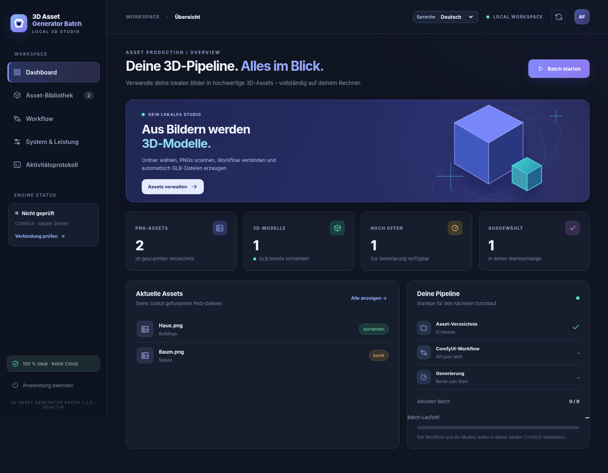
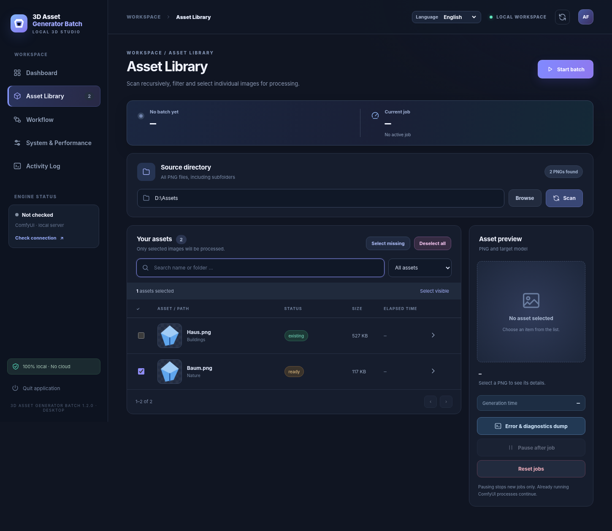

# 3D Asset Generator Batch 1.2.0

**Deutsch | [English README](README_EN.md)** · **AssetFoundry** (interner Projekt-/Paketname) · Eigenständige, modulare Windows-Anwendung mit modernem, lokalem Desktop-Dashboard für **PNG → GLB** über **ComfyUI**.

**Oberfläche (Deutsch / English):** Dashboard · Asset-Bibliothek · Workflow · Systemmonitor · Protokoll · Diagnose-Dump





*Oberflächenvorschau mit synthetischen Testdaten, kein echter ComfyUI-Generierungslauf.*

> **Status:** Testversion. Scanner, Auftragssteuerung, HTTP-Verbindung, Recovery, Dateischutz und lokale Dashboard-API sind offline getestet. **Ein realer 3D-Lauf auf deiner GPU steht noch aus**, da dein eigener ComfyUI-API-Workflow und die Modelle nicht im Repository liegen.

## Sprachen / Languages

Über das Dropdown **oben rechts** oder unter **System & Leistung → Oberflächensprache** zwischen **Deutsch** und **English** umschalten. Die Änderung wirkt ohne Neustart und wird unter `%LOCALAPPDATA%\AssetFoundry\settings.json` im Feld `language` (`de` oder `en`) gespeichert. Ein Wechsel ist auch während eines aktiven Batches möglich und verändert keine GPU-/CPU-/RAM-Einstellungen und keine Jobs.

Übersetzt werden Seiten, Schaltflächen, Tooltips, Dialoge, Tabellenstatus und die bekannten Programmmeldungen. **Originale ComfyUI-Fehler, Dateinamen und Diagnose-Rohdaten bleiben unverändert**, damit sie für die Fehleranalyse aussagekräftig sind. Der Diagnose-Dump wird weiterhin nicht übersetzt; vollständige Pfade können sensible Informationen enthalten.

Der sichtbare Programmname ist ab 1.2.0 **3D Asset Generator Batch**. `AssetFoundry` bleibt der technische Paket-, Installations- und Konfigurationsname. **Keine Migration der Benutzerdaten erforderlich.**

## Schnellstart auf Windows

1. [Python 3.10 oder neuer](https://www.python.org/downloads/) installieren (im PATH oder via `py`).
2. ComfyUI mit deinem funktionierenden **Bild → 3D → SaveGLB**-Workflow und den notwendigen Modellen/Custom Nodes starten (gewöhnlich `http://127.0.0.1:8188`).
3. In ComfyUI **API-Format** exportieren (nicht den normalen UI-Workflow) und als **`workflows\API.json`** ablegen.
4. **`Start.bat` doppelklicken.** AssetFoundry startet seinen lokalen Webserver und öffnet unter Windows vorzugsweise ein **separates Edge-App-Fenster**, andernfalls deinen Browser. **Internet, CDN, Frontend-Build und Cloud sind für den Betrieb nicht nötig.**
5. In **Workflow** den Bild- und GLB-Node prüfen und speichern. Unter **System & Leistung** ComfyUI-Verbindung testen, Cooldown und Grenzen einstellen. Unter **Asset-Bibliothek** einen Ordner wählen, ein PNG markieren, **Batch starten**.

Für den ersten Test **nur ein einzelnes PNG** ohne vorhandene GLB auswählen. Das Ergebnis muss im selben Unterordner als `Bildname.glb` erscheinen. Bei mehreren Save-/Image-Nodes die richtige Zuordnung im Workflow-Tab auswählen.

**Wichtig:** Browser-App-Fenster und Hintergrundprozess laufen lokal. Um den Server zu beenden, im linken Menü **Anwendung beenden** wählen (oder im Start-Konsolenfenster **Strg+C**). Bei aktiver Generierung zuerst **Pause** wählen; der laufende ComfyUI-Auftrag wird nicht abgebrochen.

### Beispielverzeichnis

```text
D:\Assets\
├── Baum.png
├── Baum.glb              ← bereits vorhanden: standardmässig überspringen
├── Natur\
│   └── Farn.png          ← generieren: Natur\Farn.glb
└── Gebäude\
    └── Haus.png          ← generieren: Gebäude\Haus.glb
```

## Was die Anwendung kann

- Rekursiver PNG-Scanner (`.png`, `.PNG`), eindeutige Zielzuordnung **gleicher Ordner + Basisname + GLB**.
- Schnelle, such- und filterbare **Asset-Bibliothek mit kleinen PNG-Thumbnails direkt in jeder Tabellenzeile**, Auswahl und grosser PNG-Vorschau. Die Miniaturen behalten transparente Hintergründe, werden nur für sichtbare Zeilen geladen und im Speicher begrenzt zwischengespeichert. Für volle Thumbnail-Unterstützung wird **Pillow** beim ersten Start mitinstalliert (`Extras_Installieren.bat` bei Bedarf erneut ausführen). Gut sichtbare **„Alle abwählen“**-Schaltfläche setzt die gesamte Auswahl zurück, auch über Seiten und Filter hinweg.
- **Laufzeitanzeige in HH:MM:SS:** Batch-Laufzeit im Dashboard und Asset-Tab; Dauer des aktuellen ComfyUI-Auftrags sowie Einzelzeiten pro Asset. Abgeschlossene Zeiten bleiben stehen, laufende Werte aktualisieren sich sekündlich.
- **Fehler- & Diagnose-Dump** direkt aus der Asset-Bibliothek und dem Protokoll als ZIP exportieren: Systeminformationen, Status, Jobs, Prompt-IDs, Logs und ComfyUI-Fehler. Keine PNGs, GLBs oder Workflow-JSON. Standardmässig werden absolute Pfade verdeckt; relative Dateinamen können enthalten sein.
- Batch-Verarbeitung über die **lokale ComfyUI-API**, mit konfigurierbaren Bild-/Export-Nodes und GLB-Zuordnung aus der History.
- Vorhandene GLB **überspringen** oder nur für ausdrücklich ausgewählte Assets **nach Rückfrage überschreiben**.
- Vor dem Dateiaustausch Prüfung des GLB-Containers, optionale Backups, atomarer Austausch bzw. exklusives Publish.
- Persistente ComfyUI-Auftrags-IDs, Wiederaufnahme nach Neustart, Schutz vor versehentlicher Doppelgenerierung, Soft-Pause.
- Live-Anzeige CPU/RAM (`psutil`) und NVIDIA-GPU/VRAM (`nvidia-smi`) sowie Lastgrenzen für **neue** Jobs.
- **Cooldown (standardmässig 5 Sekunden)**, maximaler Ressourcen-Wartezeitraum, Job-Timeout, Polling, GPU-Monitor-Index.
- HTML/CSS/JavaScript im Projekt enthalten – **kein Node.js, CDN, Qt oder Cloud-Dienst**.

### Was die Leistungssteuerung nicht macht

Grenzwerte halten den **Start weiterer Jobs** zurück. Sie können **nicht** die Rechenleistung einer bereits laufenden ComfyUI-Instanz hart deckeln oder deren GPU wechseln. Der GPU-Index steuert nur, welche NVIDIA-Karte überwacht wird. Nicht verfügbare GPU-Werte werden als „–“ angezeigt; daraus werden keine fiktiven Grenzwerte abgeleitet.

## Datensicherheit und Recovery

- Server bindet nur an **127.0.0.1** mit zufälligem Port und einem **zufälligen Sitzungstoken**. API-Aufrufe brauchen den Token und Browser-POSTs sind gegen fremde Origins abgesichert. Keine Cloud-Komponente, keine externe Telemetrie.
- GLB wird erst als `.part` im Zielordner gespeichert, auf glTF-2.0-Struktur geprüft und danach veröffentlicht. Bei fehlerhaftem Download bleibt die alte GLB erhalten.
- Backups beim Ersetzen unter `.assetfoundry/backups`; Jobs unter `.assetfoundry/jobs.json`; Metadaten des letzten Batches unter `.assetfoundry/last-run.json`; ordnerbezogener Lock verhindert parallele Läufe.
- Laufzeiten bleiben nach regulärem Beenden/Neustart nachvollziehbar. Bei einem harten Prozessabbruch ohne Abschlussmarker zeigt die Oberfläche den Lauf als **unterbrochen** und stoppt die Uhr an der letzten gespeicherten Statusmeldung (Heartbeat).
- Unklare ComfyUI-Aufträge werden **nicht blind erneut eingereicht**. Bei Fehlern erst im Protokoll und in ComfyUI prüfen, dann ggf. ausgewählte Jobs ausdrücklich zurücksetzen.
- PNG-Signatur und Dateigrösse werden geprüft; Symlinks und Namenskollisionen gesperrt.
- **Keine visuelle Qualitätsbewertung**: GLB in Blender/Viewer öffnen und Geometrie, Texturen, Massstab und Orientierung kontrollieren.

## Entwicklung, Tests und GitHub

Projekt klonen oder ZIP entpacken, danach:

```powershell
python -m unittest discover -s tests -v
python -m compileall -q assetfoundry
python -m assetfoundry
```

Optional mit installierbarem Paket:

```powershell
python -m pip install -e ".[extras]"
assetfoundry
```

Das Repository enthält `.gitignore`, `.gitattributes`, `pyproject.toml`, GitHub Actions (`.github/workflows/ci.yml`), Dokumentation und Offline-Tests. Persönliche Einstellungen, Jobs, GLB-Dateien und dein Workflow `workflows/API.json` werden **nicht** mitcommittet.

**Kein Lizenzvertrag ist vorgegeben:** Entscheide vor einer Veröffentlichung, ob das Repository privat bleiben soll und welche Lizenz gegebenenfalls gewünscht ist. Die fehlende Lizenzdatei erteilt keine allgemeinen Nutzungsrechte an Dritte.

### Update auf 1.2.0

Zuerst den laufenden Batch nach dem aktuellen Auftrag pausieren und **AssetFoundry schliessen**. Danach die neuen Programmdateien in den bisherigen Projektordner kopieren. Eigene `workflows/API.json` und deine ausgewählten Asset-Ordner **nicht überschreiben/löschen**. Einstellungen bleiben im Benutzerprofil (`%LOCALAPPDATA%\AssetFoundry\settings.json`); Jobzustand und Backups bleiben im Asset-Verzeichnis unter `.assetfoundry/` erhalten. Beim ersten Start prüft `Start.bat` erneut die optionalen Pakete für Miniaturansichten. Sind sie bereits installiert, ist keine erneute Installation erforderlich. Bestehende Laufzeitdaten und Einstellungen bleiben bestehen.

### Neu in Version 1.2.0

- Deutscher und englischer Sprachkatalog unter `assetfoundry/frontend/locales/` ohne Drittanbieter-Übersetzungsdienste.
- Sprachumschaltung im Header und auf der Einstellungsseite, ohne laufende Jobs zu beeinflussen.
- Persistenz und sichere Validierung über einen eigenen lokalen `/api/language`-Endpunkt.
- Titel und Browserfenster heißen **3D Asset Generator Batch**; bestehender Dateipfad und interne Modulnamen bleiben erhalten.
- Automatisierte Tests für Übersetzungskataloge, Spracheinstellung, API-Schutz und Upgrade-Kompatibilität.

### Diagnose-Dump verwenden

In **Asset-Bibliothek → Fehler- & Diagnose-Dump** oder **Aktivitätsprotokoll → Fehler- & Diagnose-Dump** klicken. Zwischen **„Absolute Ordnerpfade verdecken“** (Standard) und **„Vollständige Pfade“** wählen. Der Browser speichert ein `AssetFoundry-Diagnose-YYYYMMDD-HHMMSS.zip` lokal.

Das ZIP enthält `diagnose.json`, `jobs.json`, `recent_events.json`, `activity.log`, `errors.log` und `LIESMICH.txt`. Fehlermeldungen können Dateinamen und technische Details enthalten. **Vor dem Teilen prüfen**, vor allem bei GitHub-Issues. Den Dump nie ungeprüft in ein öffentliches Repository hochladen.

### Neuerungen in Version 1.1.2

- **Miniaturbilder links vom Asset-Namen**, mit schmalem Rahmen und transparenzfreundlichem Schachbrett-Hintergrund.
- **Lazy Loading:** Es werden nur Bilder geladen, die in der aktuellen Tabellenansicht tatsächlich sichtbar sind; maximal vier gleichzeitige Thumbnail-Anfragen.
- **Begrenzter Cache:** Thumbnail-Server: maximal 256 Einträge bzw. 16 MiB RAM. Browser: maximal 200 Bild-URLs, nach Verlassen des Asset-Ordners invalidiert. Dateigrösse und Änderungszeit erkennen geänderte PNGs beim nächsten Scan.
- **Sichere lokale API:** `/api/thumbnail?rel=…` akzeptiert nur gescannte Assets und verlangt denselben Sitzungstoken wie die übrigen lokalen APIs. Es werden keine Original-PNGs in den Diagnose-Dump aufgenommen.
- **Pillow:** Ohne Pillow gibt es bei kleinen PNGs bis 256 × 256 Pixel und 192 KiB einen Fallback; für grössere PNGs bleibt ein Platzhalter sichtbar. `Extras_Installieren.bat` installiert Pillow nach.

Weitere technische Details: [docs/ARCHITEKTUR.md](docs/ARCHITEKTUR.md) und [docs/SECURITY.md](docs/SECURITY.md).

## Projektstruktur

```text
AssetFoundry/
├── Start.bat                    Start in separatem Edge-App-Fenster / Browser
├── Extras_Installieren.bat      Optionale psutil/Pillow Installation
├── Tests_Starten.bat            Offline-Tests
├── pyproject.toml               Installations-/Paket-Metadaten
├── .github/workflows/ci.yml     CI (Python 3.10 / 3.12 / 3.13)
├── assetfoundry/
│   ├── __main__.py              Startpunkt
│   ├── dashboard.py             UI-unabhängiger Dashboard-Controller
│   ├── webapp.py                Loopback-Server und geschützte lokale JSON-API
│   ├── frontend/
│   │   ├── index.html           Dashboard, Asset-Bibliothek, Workflow, System, Logs
│   │   ├── styles.css           Modernes responsives Dark Theme
│   │   ├── app.js               Browser-Interaktionen ohne Framework
│   │   ├── i18n.js              Sprachumschaltung + Übersetzungsadapter
│   │   └── locales/             de.json / en.json
│   ├── assets.py                Scanner
│   ├── batch.py                 Batch-Engine und Recovery
│   ├── comfy.py                 ComfyUI-HTTP-Client
│   ├── models.py                Modelle / Einstellungen
│   ├── output.py                GLB-Prüfung und Safe-Publish
│   ├── resources.py             CPU/RAM/NVIDIA-Monitoring
│   ├── state.py                 Job-Store / Batch-Zeitdatei / Lock
│   ├── thumbnails.py            Kleine PNG-Thumbnails mit RAM-LRU-Cache
│   ├── diagnostics.py           Sicherer Fehler-/Diagnose-ZIP-Export
│   └── workflow.py              API-Workflow-Adapter
├── workflows/
│   ├── HIER_API_JSON_ABLEGEN.txt
│   └── API.json                 Dein Workflow (bewusst nicht im ZIP/Git)
├── tests/                       Offline-Tests, inkl. API-Sicherheit
└── docs/                        Architektur & Sicherheit
```

Mehr über die Spracharchitektur: [docs/LOCALIZATION.md](docs/LOCALIZATION.md).
