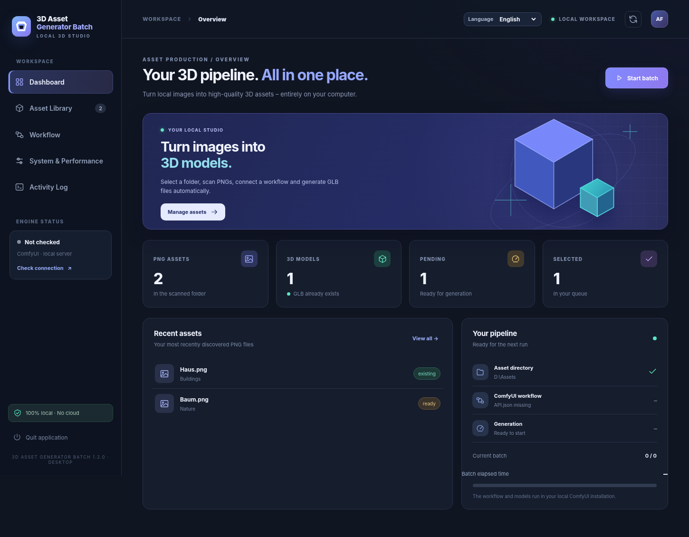

# 3D Asset Generator Batch 1.2.0

**Language: [Deutsch](README.md) | English**

Formerly displayed as *AssetFoundry*; **AssetFoundry remains the internal project/package/configuration name** for upgrade compatibility.

*Screenshots use synthetic test data, not a live GPU generation run.*

A modular, local-first Windows application for processing PNG images recursively through a ComfyUI API workflow and saving generated GLB files alongside each source PNG. No cloud account or API key is needed.

## Quick start (Windows)

1. Install **Python 3.10+** and start your local ComfyUI server with the required image-to-3D models and custom nodes.
2. Export a supported workflow in **ComfyUI API format** and save it as `workflows\API.json`. The graphical workflow JSON is not the same as API JSON.
3. Unzip the project and run **`Start.bat`**. The application uses a local Edge app window when available, or your default browser.
4. Set the language to **English** using the selector in the top bar or **System & Performance → Interface language**.
5. On **Workflow**, inspect the image input node and the GLB export node, then save the mapping. On **System & Performance**, configure resource thresholds and connect to ComfyUI.
6. On **Asset Library**, choose a source folder, scan its subfolders, and select **one PNG** for your first generation. Select **Start batch**.

## Features

- Recursive `.png` scanner and same-folder, same-basename `.glb` matching.
- Asset list with lazy-loaded thumbnails, filtering, selection and large PNG preview.
- Skip existing GLBs by default or explicitly confirm safe replacement with optional backups.
- Sequential local ComfyUI jobs, persistent prompt IDs and recovery, pause after current job.
- Batch and per-job timers, diagnostics ZIP export, performance metrics for CPU/RAM/NVIDIA GPU/VRAM.
- A configurable cooldown (5 seconds by default) and resource gating before new jobs. These settings **do not hard-limit an active ComfyUI job's utilization**.
- German/English interface with language switching **without interrupting active jobs**. The preference is saved locally.
- Offline static frontend; no frontend build system or CDN required.

## Diagnostics and privacy

Everything runs locally on `127.0.0.1` behind a session token. The diagnostics ZIP can include names and technical errors, so check it before sharing. PNGs, generated GLBs and workflow JSON are not included. Original ComfyUI errors remain in their original language for troubleshooting.

## Updating from 1.1.x

Finish/pause the active job and close the application. Copy the updated program files into the existing folder, preserving your own `workflows\API.json`. Configuration remains in `%LOCALAPPDATA%\AssetFoundry\settings.json`; job state/backups remain in `.assetfoundry/` under the selected asset root. No manual migration is needed.

## Tests

Run `Tests_Starten.bat`, or use `python -m unittest discover -s tests -v`. The GitHub Actions workflow also runs the automated test suite.

This is a test-ready release; the actual PNG→GLB workflow still needs an integration test with your local ComfyUI models and GPU. Read [architecture](docs/ARCHITEKTUR.md), [security](docs/SECURITY.md), and [localization notes](docs/LOCALIZATION.md).
